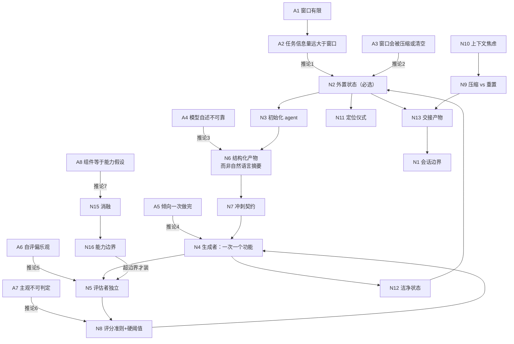

# Anthropic 持续运行智能体（Long-Running Agent）知识图谱拆解

> **定位**：外部研究 → 知识图谱 → 落到 mocode 的差距清单与分期方案
> **原始材料**：Anthropic 两篇工程/研究文章（全文已落盘本地，可复核）
> **本地副本**：`~/research/anthropic-long-running/A-effective-harnesses-for-long-running-agents.txt`（文章 A 全文）、`~/research/anthropic-long-running/B-harness-design-for-long-running-apps.txt`（文章 B 全文）
> **抓取方式**：CONNECT 代理 + 独立 CA bundle 的自研取数器（`~/research/anthropic-long-running/httpc3.mjs`）→ 页面 Next.js RSC payload 抽取 → HTML 去标签
> **对标对象**：mocode `v0.27.0`（`github.com/nextsko/mocode-agent`，commit `275f15f`）

---

## 0. 这份文档在解决什么问题

这两篇文章**不是教程，是实验报告**。作者 Justin Young 明确写了它们只是"one possible set of solutions"，而且文章 B 结尾给出了一条元教训：

> "every component in a harness encodes an assumption about what the model can't do on its own, and those assumptions are worth stress testing, both because they may be incorrect, and because they can quickly go stale as models improve."

所以**照抄结论是危险的**。本文要做的是三件事：

1. 把两篇文章里的**隐性结构**显性化 → **知识图谱**（节点 / 边 / 失效模式 ↔ 对策矩阵）；
2. 用**第一性原理**推导出这些机制"为什么必然存在"（公理 A1–A8），让结论可迁移到别的模型、别的产品；
3. 用**费曼学习法**做四遍拆解，最后落到 **mocode 的差距清单 + 分期落地方案**。

读者：要做长时自主编码（数小时到数天）的 mocode 维护者。

---

## 1. 原始材料清单

| # | 文章 | 发布 / 更新 | 一句话 | 本地全文 |
|---|---|---|---|---|
| A | *Effective harnesses for long-running agents* | 2025-11-26 / 2026-10-18 | 初始化 agent + 增量编码 agent + 结构化交接，让 agent 跨多个上下文窗口持续推进 | `~/research/anthropic-long-running/A-effective-harnesses-for-long-running-agents.txt` |
| B | *Harness design for long-running apps* | 2026-03-24 / 2026-10-18 | 把 A 的两段式升级成 planner / generator / evaluator 三段式，并给出"何时该删掉 harness 组件"的判据 | `~/research/anthropic-long-running/B-harness-design-for-long-running-apps.txt` |
| C | *Building a C compiler with a team of parallel Claudes*（B 的相关文章） | 2026-02-05 | 同一团队在"大规模并行 + 长时运行"方向上的另一条实验线 | 未抓取（仅作延伸阅读） |

作者：A = Justin Young；B = Prithvi Rajasakeraran（Labs team）。

**两篇文章的分工**：A 解决"**跨会话不丢状态**"，B 解决"**跨会话之外还要跨角色**"以及"**harness 自身需要被质疑**"。B 是 A 的超集加批判，两篇必须一起读，否则容易只学 A 的文件技巧、漏掉 B 的角色分离。

---

## 2. 第一性原理：为什么"持续运行"注定会失败

把问题拆到不能再拆，剩下的就是 8 条公理。**后面所有机制都是这 8 条的推论**——记住公理比记住技巧重要，因为模型换代后技巧会过期，公理不会。

### A1 上下文窗口是有限资源

事实：单次上下文窗口容量为 `F`（有限）。
任何"让模型一直干活"的方案，本质上都是在 `F` 的边界上做调度。

### A2 复杂任务的语义量必然超过窗口

事实：一个值得做的项目，所需信息量 `I ≫ F`。
**推论 1（外置状态是必选项，不是优化项）**：任何方案都必须把信息搬到窗口之外。没有外置状态的方案一定是"假连续"。

### A3 窗口是唯一可靠的工作记忆，但它会被清空或压缩

事实：上下文会被 compaction（原地摘要）压缩，也会被 reset（直接清空）清掉。
**推论 2**：跨窗口连续性 = `f(外置状态的丰富度, 恢复协议的成本)`。两者此消彼长：状态越薄，恢复越贵（模型要猜）。

### A4 模型对自己状态的认知不可靠

三个子事实：
- 压缩会丢信息，且不保证把指令传给下一个 agent（A 原文："compaction doesn't always pass perfectly clear instructions"）；
- 模型在接近自认为的上下文上限时会"焦虑收尾"（B 原文称之为 **context anxiety**）；
- 模型给自己产出的评分系统性偏乐观（B 原文：generator 评自己的作品"confidently praising"）。
**推论 3**：状态必须**写出来**，且要写成**另一个 agent 可以不猜就接上**的结构化产物。自然语言摘要不够，因为摘要本身也是模型生成的、同样会乐观。

### A5 任务粒度大于单窗口容量时，模型倾向"一口气做完"

事实（A 原文第一条失效模式）：给一句 "build a clone of claude.ai"，Opus 4.5 也会试图 one-shot，中途耗尽上下文，留下半成品且无文档，下一个会话只能猜。
**推论 4**：必须由**外部调度**强制"一次只做一件事"。提示语约束不可靠——它必须落在产物结构上（例如"一个 sprint 只允许改一个 feature 条目"）。

### A6 评价必须与生产分离

事实（B 原文第二节）：让 agent 评自己的活儿，它会夸；即使在有可验证测试的任务上，它也常"完成了任务但判断很差"。但**把一个独立 evaluator 调成怀疑派，是可行的**（"tuning a standalone evaluator to be skeptical turns out to be far more tractable than making a generator critical of its own work"）。
**推论 5**：generator / evaluator 必须是两个上下文、两套提示、两份产物。

### A7 主观质量必须先变成可打分的准则

事实（B 原文第二节）："这设计好不好看"不可判定，但"是否符合我们的设计原则"可以打分。
**推论 6**：需要 **grading criteria**（准则 + 权重 + 硬阈值），并且打分者要有能力（浏览器自动化）真的去看。

### A8 harness 的每个组件都是"模型做不到什么"的假设

事实（B 原文 "Iterating on the harness"）：作者逐个删组件做消融，发现 **sprint 结构**在 Opus 4.6 上已不再承重，删掉后性能不降。
**推论 7**：harness 必须支持**逐组件消融**，否则你无法知道哪块是真承重、哪块是历史包袱。**换模型 = 重做消融**。

> 公理链：**A1+A2 ⇒ 必须外置状态（A3）⇒ 状态要结构化、可被他人读（A4）⇒ 单次只做一件事（A5）⇒ 生产与评价分离（A6）⇒ 评价要有可打分准则（A7）⇒ harness 要可消融（A8）**。

---

## 3. 知识图谱

### 3.1 节点（16 个）

| ID | 节点 | 定义 | 判定标准（怎么算做到了） | 典型失效 |
|---|---|---|---|---|
| N1 | 会话边界 Session Boundary | 一次 agent 运行的起止 | 新会话无任何前情 | 用同一上下文硬撑，末尾崩溃 |
| N2 | 外置状态 Externalized State | 存在窗口之外、下一会话可直读的事实载体 | 新 agent 只读文件即可复述现状 | 只有自然语言总结，细节丢失 |
| N3 | 初始化 agent Initializer | 第一次会话专职搭环境 | `init.sh` + 进度文件 + 首次 git commit 齐备 | 跳过初始化，后续 agent 不知道从哪跑 |
| N4 | 生成者 Generator / Coding Agent | 每个会话专职推进一个功能 | 一次会话只改一个 feature 条目 | 一次做太多，中途半成品 |
| N5 | 评估者 Evaluator / QA | 独立上下文、独立提示的评判方 | 评估报告来自不同会话/不同 agent | 自评自夸，形式化打分 |
| N6 | 特征清单 + 门禁 Feature List & Gate | 可判定的功能清单 + 逐项 pass 标记 | JSON 清单，每项含 `steps` 与 `passes` | 清单是 Markdown → 模型顺手改测试/删条目 |
| N7 | 冲刺契约 Sprint Contract | 事前协商"这轮做到什么算完成" | 写代码之前双方对验收口径达成一致 | 事中解释"done"，标准漂移 |
| N8 | 评分准则 Grading Criteria | 把主观判断转成可打分项 + 权重 + 硬阈值 | 4 条准则（质量/原创/工艺/功能）+ 阈值 | 只给生成者看，没有独立打分者 |
| N9 | 压缩 vs 重置 Compaction / Reset | 原地摘要 vs 换 agent + 结构化交接 | 各自适用条件明确 | 把 compaction 当作"解决了一切" |
| N10 | 上下文焦虑 Context Anxiety | 模型自认为快没上下文时提前收尾 | 能观测到"提前宣布完成" | 把它误判成"模型偷懒" |
| N11 | 定位仪式 Getting-up-to-speed | 会话开头的固定动作序列 | `pwd → 读进度/git log → 读清单 → 跑冒烟测试 | 每次会话重新摸索，浪费 token 且易踩坏状态 |
| N12 | 洁净状态 Clean State | 会话结束时代码达到"可合并"水准 | 无重大 bug、文档齐、他人可接手 | 留下一堆半成品，污染下一个会话 |
| N13 | 交接 Handoff Artifact | 重置时携带的状态包 | 新 agent 不需要猜即可接续 | 交接文档写成"我的思考过程"而非"当前事实" |
| N14 | 成本账本 Cost Ledger | 每个阶段的钱与墙钟时间 | 按 phase 归因（planner/build/QA 各自耗时与成本） | 只知道总额，不知道钱花在哪 |
| N15 | 消融 Ablation | 逐组件删除以验证承重 | 能说出"删掉 X 后指标变化多少" | 组件越加越多，没人敢删 |
| N16 | 能力边界 Capability Boundary | 任务是否超出当前模型独自可靠完成的范围 | 边界随模型版本移动 | 固定装配 evaluator，对所有任务都付费 |

### 3.2 边（关系图）



> 读图要点：**N2（外置状态）是所有东西的根**；N5/N8/N16 构成一条带成本闸门的回路（评估 → 反馈 → 再生成），N16 决定这条回路要不要装。

### 3.3 失效模式 ↔ 对策矩阵

文章 A 的原表（四条）+ 文章 B 补充的两条，合并如下：

| 失效模式 | 出处 | 对策 | 机制节点 |
|---|---|---|---|
| 想一口气做完整个应用，中途耗尽上下文 | A | 初始化 agent 写下功能清单；编码 agent 一次只做一个功能 | N3 N6 N4 |
| 整个项目提前宣布完成 | A | 建功能清单；**逐项自测通过后**才把 `passes` 置 true | N6 |
| 结束时会话留下有 bug 或没文档的状态 | A | 会话开始读进度文件 + git log，结束写 git commit + 进度更新 | N2 N12 |
| 每次会话都要重新摸索怎么跑起来 | A | 写 `init.sh`；会话开头先跑基本端到端测试 | N11 |
| 没真正测试就标记功能完成 | A | 明确要求用浏览器自动化、以人类用户的方式验证 | N5 N8 |
| 上下文将满时提前收工（context anxiety） | B | 用**上下文重置 + 结构化交接**替换单纯压缩 | N9 N13 |
| 自评自己的作品偏乐观 | B | 生产与评价分离；把 evaluator 调成怀疑派 | N5 N8 |

---

## 4. 费曼式拆解（四遍）

### 第 1 遍：讲给完全不懂的人

想象一个**夜班工程师班组**。

- 每个工程师班次只能带一张 A4 纸的工位（上下文窗口）。纸用完了，脑子就清零。
- 但项目是"造一个像 claude.ai 的应用"，需要的信息量是一本字典。
- 班次交接时，如果只留一句口头交代（"我做到一半了"），下一班就会花一半时间去猜、去修坏掉的东西。
- 所以班组养了两条规矩：
  1. **第一班是开荒班**：不写业务，只搭台子——写好"怎么把项目跑起来"的脚本（init.sh）、建一本**待办清单**（每条都有勾选框）、做第一次提交。
  2. **之后的每班只领一条待办**：做完一条、勾上、写清进度、提交代码，然后下班。交班时留下的是**可合并的代码 + 一本清单**，不是"我的思路"。
- 最后加一条：**质检班不能是干活的人自己**。自己盖的楼自己评，永远是"漂亮"。

### 第 2 遍：讲给同行（一次 sprint 的时间线）

```
规划（planner，分钟级）
  输入：一句话需求
  输出：产品级规格（做什么、为什么、范围多大）——刻意不写实现细节
        因为规格一旦写错，错误会级联到下游

契约（generator + evaluator 协商，分钟级）
  generator：这一轮我打算做 X，验收方式是 Y（可测）
  evaluator：我按 Y 去点一遍，如果这样算过，就签字
  → 两边迭代到一致为止（文章 B：contract criterion 可以细到 27 条）

执行（generator，小时级）
  一次一个 feature；每轮结束自评一次；用 git 留下可回滚的检查点

质检（evaluator，独立上下文）
  用 Playwright 像用户一样点：UI 功能、API 端点、数据库状态
  按准则打分：产品深度 / 功能 / 视觉 / 代码质量；任何一项低于硬阈值 → 本轮不合格
  反馈必须具体到"文件:行 + 错在哪 + 期望是什么"

交接（跨上下文窗口时）
  写交接产物：新 agent 读它就能接上（文章 A 的 init/progress/git；文章 B 的 reset+handoff）
```

关键区别：**契约在写代码之前协商**。文章 B 明确说这一步存在的理由是"规格故意写得高层，需要一个步骤把用户故事桥接到可测实现"。

### 第 3 遍：我哪里讲错了（常见误解 8 条）

| 误解 | 实情 |
|---|---|
| "压缩（compaction）就够了" | 压缩保留连续性，但**不清理上下文**，context anxiety 仍在；文章 B 明确说 Sonnet 4.5 上"compaction alone wasn't sufficient" |
| "重置永远优于压缩" | 重置给干净起点，代价是交接产物必须够厚；文章 B 在 Opus 4.5 上直接**删掉了重置**（Opus 4.5 自己就没有焦虑） |
| "有了进度文件就够了" | 进度文件解决"知道做到哪"，不解决"知道什么算做完"；还需要清单 + 契约 + 门禁 |
| "清单用 Markdown 就行" | 文章 A 明确说**改用 JSON**，因为模型更少去不当覆盖 JSON 而不是 Markdown |
| "让 agent 自己测自己就行" | 会自夸；且"改了代码、跑了单测"≠"端到端可用" |
| "评分准则越多越好" | 文章 B 的权重选择很关键：**放大赛后两项**（设计质量、原创性），因为工艺与可用性模型本来就默认做得好 |
| "一定要写 planner" | 文章 B 消融后**保留了 planner**（去掉会让 generator 欠规格、成品更单薄） |
| "evaluator 一定要一直开着" | 文章 B：evaluator **不是固定的是/否开关**——当任务落在模型独自可靠完成的边界内时它是纯开销；边界随模型版本移动 |

### 第 4 遍：一页纸版（可直接贴墙）

```
持续运行的 agent = 一个没有记忆的工人 + 一套外部的排班制度

1. 状态写在纸上（进度 / 清单 / git），不写在脑子里。
2. 第一个班次搭台子（怎么跑、做什么、怎么算完）。
3. 之后的班次一次只领一件事，做完勾上、提交、留干净状态。
4. 交接只留事实，不留心路。
5. 质检另一个人干（有标准、有阈值、能真的去点）。
6. 换模型时，重新做一遍消融：哪些架子已经不需要了。
```

---

## 5. 映射到 mocode：已覆盖 / 部分 / 缺失

> 判定口径：✅ 已覆盖（机制在位且可被触发）｜🟡 部分（有资产但缺编排/门禁）｜❌ 缺失

| 机制 | mocode 现状（文件） | 判定 | 差距要点 |
|---|---|---|---|
| 外置状态（进度/发现/计划） | `internal/core/skills/builtin/planning-with-files/SKILL.md`：`.plans/{task_plan,progress,findings}.md` | ✅ | 三件套齐全 |
| 交接产物（重置式交接） | `internal/core/skills/builtin/handoff/SKILL.md` | ✅ | 明确"读者没有你的上下文" |
| 会话记忆（文件为基座） | `docs/design/18-session-memory-protocol.md`、`internal/core/memory/`、`internal/core/memgraph/` | ✅ | 原子写、萃取、`mocode://memory/` |
| 压缩侧（compaction） | `internal/core/agent/ctxcompress/pipeline.go`（`LevelSummary` 等层级） | ✅ | 但只有压缩，**无重置** |
| 定位仪式 | 依赖模型自觉 + `AGENTS.md` | ❌ | 没有 harness 层的强制开局序列 |
| 初始化 agent | 无专门角色 | ❌ | 第一次会话与后续会话没有分工 |
| 功能清单 + 门禁 | 有 plan 文档，无机器可判定的 `passes` 清单 | ❌ | 缺"逐条验收 + 禁止改测试"的强约束载体 |
| 冲刺契约（事前协商 done） | 无 | ❌ | 没有"写代码前先对齐验收口径"的环节 |
| 生成者 | `internal/core/agent/subagent_cards/core/code.md` | ✅ | — |
| 规划者 | `internal/core/agent/subagent_cards/orchestrator/planner.md` | 🟡 | 有角色，未接入自动流水线 |
| 评估者 | `internal/core/agent/subagent_cards/testing/testing-reality-checker.md`（"默认 NEEDS WORK，除非被证明"） | 🟡 | 有怀疑派角色，**缺硬阈值与独立上下文契约** |
| 评分准则 | `internal/core/skills/builtin/design-taste-frontend/` 等 skill | 🟡 | 准则只喂给生成者，没有独立打分者按同准则打分 |
| 端到端验证能力 | `internal/core/browser/`、`internal/ui/dissect`、playwright-cli skill | ✅ | 关键底座已在 |
| init.sh 等价物 | `scripts/devship.sh` + `Taskfile.yaml` | ✅ | 仓库已有"构建→测试→原子替换"闭环 |
| 洁净状态 | `scripts/devship.sh`（原子替换）+ git 提交习惯 | ✅ | — |
| 成本账本 | `mocode stats` 有用量统计 | 🟡 | 无 **phase 级**归因（planner/build/QA 各花多少） |
| 消融能力 | 无实验记录规范 | ❌ | 不知道哪些 skill / 哪些 harness 组件是承重的 |
| 能力边界判据 | 无 | ❌ | 所有任务都按同一套装配，边界外的任务被浪费，边界内的任务被拖慢 |

---

## 6. 落地建议（三期）

### P0：低成本、高收益，先把"事实载体"补齐

1. **可判定的功能清单（JSON）** —— 对标 N6。
   形态：`.plans/<topic>/features.json`，每项 `{id, category, description, steps[], passes}`。
   规则（抄文章 A 的硬约束）：**只允许改 `passes`，不得删改条目或测试**；`passes` 置 true 前必须留下验证证据（命令 + 输出）。
2. **定位仪式 skill** —— 对标 N11。
   会话开头固定跑：`pwd` → 读 `progress.md` + `git log` → 读 `features.json` → 选最高优先级未完成项 → 跑一次冒烟测试（`scripts/devship.sh --fast` 或项目自带）。
3. **验收门禁** —— 对标 N6 的 `passes` 语义：清单里存在 `passes=false` 的条目时，收尾流程必须显式说明"本轮为何没做完"。

**验收标准**：造一个 3 条功能的小任务，跑两轮会话；第二轮 agent 能仅凭 `progress.md` + `features.json` + git log 说清现状，且不重复已完成工作。

### P1：把"评估者"从角色升级为机制

1. **冲刺契约** —— 对标 N7：生成方先写"这轮做什么 / 怎么验证"，评估方签字后才开写。
2. **评分准则 + 硬阈值** —— 对标 N8：沿用 `design-taste-frontend` 的四类准则，但**评估方拿同一份准则**；任一项低于阈值 → 本轮不合格并附具体证据（文件:行 + 期望 vs 实际）。
3. **phase 级成本归因** —— 对标 N14：给 agent 运行打上 phase 标签（plan / build / eval），`mocode stats` 按 phase 汇总时间与成本。

**验收标准**：同一任务的评估报告必须能指出至少一个"生成方自评没发现的"问题（可用已知缺陷做盲测）。

### P2：把 harness 变成可消融的

1. **上下文重置开关** —— 对标 N9/N13：目前只有压缩；提供"压缩"与"重置 + 交接"两种模式的显式开关，并允许按模型能力选择（文章 B 的结论：强模型不需要重置）。
2. **消融记录规范** —— 对标 N15/N16：每次调整 harness 组件（skill / 角色 / 门禁）都要记一条：改了什么、在哪个任务上测的、指标如何变化。**目标：能回答"哪些组件是承重的"**。
3. **能力边界感知的装配** —— 对标 N16：按任务类型决定是否装评估者（前端审美类几乎必装；纯重构类可省）。

---

## 7. 明确不采信 / 需要本地复验的结论

| 原文结论 | 为什么不能直接抄 |
|---|---|
| B 删除 sprint 结构（基于 Opus 4.6） | mocode 当前主力模型是 MiniMax / DeepSeek 系，**能力边界不同**。按 A8，逐组件消融在本地必须重做 |
| 成本数字（solo 20 分钟 vs harness 6 小时 / \$200；V2 3h50m / \$124.70） | 是 Opus 4.5/4.6 + 特定任务（复古游戏机、DAW）的数字，不可外推 |
| 四条设计评分准则（质量/原创/工艺/功能） | 是**前端审美**场景的准则；泛化到后端/数据/文档需要重新设计"可打分项" |
| "评估者要调成怀疑派，需要读它的日志迭代提示词" | 这条是**经验性**的：文章 B 明说"took several rounds"。mocode 若要做，应先建一个日志语料集，而不是照抄提示词 |
| compaction vs reset 的取舍 | 强依赖模型：Opus 4.5 有 context anxiety，Opus 4.6 基本没有。**先测本地模型的行为，再决定默认模式** |

---

## 8. 复核方法

1. **原文复核**：全文副本在 `~/research/anthropic-long-running/A-effective-harnesses-for-long-running-agents.txt` / `~/research/anthropic-long-running/B-harness-design-for-long-running-apps.txt`；抓取脚本 `~/research/anthropic-long-running/httpc3.mjs`（CONNECT 代理 + CA bundle + RSC payload 抽取）。本文每条结论都能在两份全文里按小节标题定位。
2. **mocode 侧复核**：本文出现的每个文件路径都可在 `~/workspaces/mocode-task`（tag `v0.27.0`）直接打开核对。
3. **重抓原文**：本机无 DNS（Go 纯解析器读不到 `/etc/resolv.conf`），取数必须走 `127.0.0.1:8081` 的 CONNECT 代理；CA bundle 在 `engine/etc/tls/cert.pem`。

---

## 附录 A：文章 A 的核心对照表（原文摘录）

| Problem（Agent 行为） | Solution（对策） |
|---|---|
| 整个项目提前宣布完成 | 建立功能清单文件：基于输入规格，生成结构化 JSON 的端到端功能描述清单 |
| 结束时会话留下有 bug 或未文档化的状态 | 写初始 git 仓库与进度记录文件；会话开头读进度与 git 日志并跑一次基本测试；会话结尾写 git commit 与进度更新 |
| 提前把功能标记为完成 | 建立功能清单文件；**自测所有功能**，仔细测试通过后才标记 passing |
| 每次会话都要花时间摸索怎么跑起来 | 写 `init.sh`；会话开头先读 `init.sh` |

（文章 A 强调的两条"硬约束"原文：① JSON 而非 Markdown，因为模型更少不当覆盖 JSON；② 强措辞指令——"It is unacceptable to remove or edit tests because this could lead to missing or buggy functionality."）

## 附录 B：文章 B 的关键数字

| Harness | 时长 | 成本 | 备注 |
|---|---|---|---|
| Solo（单 agent） | 20 min | — | 产物"看起来对"，但核心玩法**根本不能玩** |
| Full harness（Opus 4.5） | 6 hr | \$200 | 16 条功能 / 10 个 sprint；玩法能跑起来 |
| V2 harness（Opus 4.6，去掉 sprint） | 3 hr 50 min | \$124.70 | planner 4.7 min / \$0.46；build×3 轮；QA×3 轮 |

（V2 的 QA 仍抓到真问题：录音只做了 stub、片段不能拖拽缩放与切分、效果器只有数值滑块没有图形化曲线。）

## 附录 C：本文与仓库其他文档的关系

| 文档 | 关系 |
|---|---|
| `docs/design/18-session-memory-protocol.md` | 提供"状态外置"的地基，本文补上"谁来写、写什么格式、谁来读" |
| `docs/design/19-ask-user-crush-parity.md` | 同源（上游 Crush）但不同主题：ask-user 解决"人怎么回答"，本文解决"agent 怎么记住" |
| `docs/guides/08-evaluation-plan.md` | 与本文 P1 的"评估者机制"直接相关，建议合并考虑 |
| `internal/core/skills/builtin/planning-with-files/` | 已覆盖的 N2 资产，P0 的 `features.json` 应与它同目录约定 |